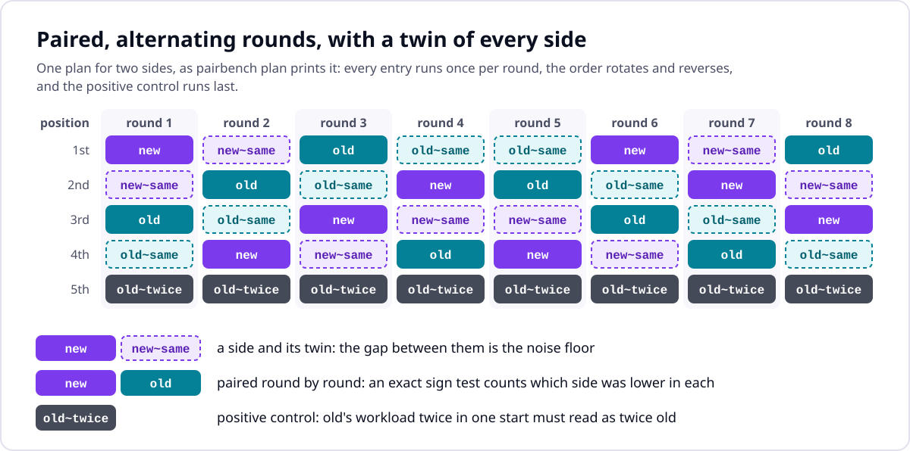
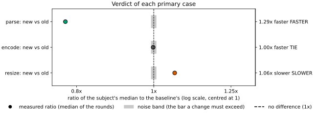

<h1 align="center"><picture><source media="(prefers-color-scheme: dark)" srcset="https://github.com/eugo-inc/pairbench/raw/main/docs/readme/banner-dark.svg"></picture></h1>

<div align="center">

<a href="https://pypi.org/project/pairbench/"></a> <a href="https://github.com/eugo-inc/pairbench/blob/main/pyproject.toml"></a> <a href="https://github.com/eugo-inc/pairbench/blob/main/LICENSE"></a> <a href="https://eugo.io/docs/pairbench/latest/"></a>

**Is one side really faster than another on this workload, on this machine, or is the difference noise?**

**[Documentation](https://eugo.io/docs/pairbench/latest/)** · [Quick start](https://eugo.io/docs/pairbench/latest/quickstart/) · [How it decides](#how-it-decides) · [For AI agents](#for-ai-agents) · [Showcases](#showcases)

</div>

<p align="center"></p>

<p align="center"><i>Made-up values from <a href="https://github.com/eugo-inc/pairbench/blob/main/docs/readme/demo/made_up_bench.py">a seeded generator</a>; the session is <a href="https://github.com/eugo-inc/pairbench/blob/main/docs/readme/demo/tape.sh">docs/readme/demo/tape.sh</a>.</i></p>

pairbench runs both sides in paired, alternating rounds, measures the noise in the same
rounds, and gives a verdict per case with its noise bar and an exact p-value.

```
pip install pairbench
pairbench run --side new=venv:.venv-new --side old=venv:.venv-old -- python bench.py
```

Two Python environments, one script, a verdict per case. More ways in
[Install and quick start](#install-and-quick-start) and the
[headline command](#the-headline-command).

- **Paired, alternating rounds.** Every side runs once per round, in an order that rotates and
  reverses, so no side keeps running before another.
- **A measured noise floor.** Every side has a twin, an identical copy in the same rounds; the
  gap between them is the noise the verdict has to beat.
- **An exact test, corrected.** An exact sign test per case, corrected for testing several
  cases at once.
- **A positive control.** The baseline's workload twice in one start must read as twice the
  value, or every comparison of the run gets `NO VERDICT`.
- **Any side.** A container image, a Python environment or any command, read by built-in
  drivers for common benchmark tools.
- **Built for agents.** A skill, a tool server, JSON Schemas and exit codes that say what
  happened.

## The headline command

```
pairbench run --side new=image:myorg/app:2.0 --side old=image:myorg/app:1.9 -- python bench.py
```

Example output (made-up numbers):

```
new against old (baseline)

case    new     old     change        noise  p        verdict
matmul  1.92 s  2.41 s  1.26x faster  ±1.8%  0.0010*  FASTER
fft     0.88 s  0.89 s  1.01x faster  ±2.1%  1.0*     TIE

Exact two-sided sign test over 16 paired rounds.
* corrected for testing 2 cases at once.
Rule: strict.
Machine state: quiet.
Baseline: old.
Positive control old~twice: ok.
```

`FASTER` needs two things at once: the gap is wider than the noise the run measured between
each side and an identical copy of itself, and the direction is significant after the
correction for testing several cases. `TIE` needs the same evidence the other way round.
Anything else is `UNRESOLVED` or `NO VERDICT`, with the reason in plain words.

## Four problems it solves

| Problem | What you get |
|---|---|
| [Real or noise](#real-or-noise) | a verdict for every case, with the noise and the p-value beside it |
| [Comparing whole environments](#comparing-whole-environments) | container images, Python environments or any command, identified before and after |
| [A busy shared machine](#a-busy-shared-machine) | wait for quiet, pin, lock, and set disturbed rounds aside |
| [Numbers into documents](#numbers-into-documents) | every number of a report filled from a results file, and checked |

### Real or noise

One command gives a verdict for every case of a benchmark, with the noise and the p-value
beside it. Here two Python environments run the same script, which prints its own timings:

```
pairbench run --side new=venv:.venv-new --side old=venv:.venv-old --driver lines -- python bench.py
```

Example output (made-up numbers):

```
case     new       old       change        noise  p        verdict
parse    0.310 s   0.402 s   1.30x faster  ±1.2%  0.0016*  FASTER
encode   1.020 s   1.010 s   1.01x slower  ±1.4%  0.21*    TIE
resize   0.555 s   0.571 s   1.03x faster  ±3.9%  0.0084*  UNRESOLVED (the difference is significant but lies inside the noise)
```

### Comparing whole environments

A side can be a container image, a Python environment or any command. Before a run,
`pairbench plan` prints what will run and checks that the sides are not the same thing:

```
pairbench plan --side pip=image:myorg/numpy-pip:1 --side conda=image:myorg/numpy-conda:1 -- python bench.py
```

<details>
<summary>Example output (made-up identities, shortened)</summary>

```
# lineup: pip, pip~same, conda, conda~same
# positive control: conda~twice, last in every round at position 5
# rounds: requested auto, planned 16
# launches: 82 (16 rounds of 5, and 2 warm-up launches)
# balance pip / conda: pip first in 8, conda first in 8, positions differ by 0 in sum
# verdict: reachable; 13 of 16 rounds must agree for one primary case when none tie (a tie is not counted)
# side pip: identified (image_id=sha256:aaaa..., digests=sha256:bbbb...)
# side conda: identified (image_id=sha256:cccc..., digests=sha256:dddd...)
```

</details>

Each side is identified before the run and again after it; two sides with the same identity
are refused, and so is a side whose identity changed during the run.

### A busy shared machine

On a machine other people use, pairbench can wait for quiet, pin the workload to a CPU set,
take a lock, and watch every launch for load that is not the run's own:

```
pairbench run --side new=cmd:./bench-new --side old=cmd:./bench-old --cpus 4-7 --wait-quiet --lock /tmp/bench.lock
```

Example footer (made-up numbers):

```
Machine state: busy.
Without disturbed rounds 3, 11, matmul (new against old): 0.80x FASTER, agrees.
```

A round is set aside by a witness that never looks at the timings, and the analysis is
repeated without it. Setting rounds aside can only downgrade a verdict, never create one.

### Numbers into documents

Every number in a report can come from a results file instead of being typed by hand. A
template holds tokens such as &#123;&#123;fig:matmul.new_vs_old.ratio&#125;&#125;, and:

```
pairbench fill report.in.md --results results.json -o report.md
```

writes the document with each token replaced by its figure, for example `0.80x` (a made-up
value). A missing figure stops the command with exit code 7 and lists every missing key.
`--check` proves in an automated pipeline that a document still matches its results.

## Install and quick start

```
pip install pairbench
pairbench doctor
pairbench selftest
```

`doctor` says what this machine supports and which external tools it found. `selftest`
runs the known answers and controls of the statistics. Then print a plan, and run it:

```
pairbench plan --side new=venv:.venv-new --side old=venv:.venv-old -- python bench.py
pairbench run  --side new=venv:.venv-new --side old=venv:.venv-old -- python bench.py
```

The [quick start](https://eugo.io/docs/pairbench/latest/quickstart/) walks through a first
run and what each part of the output means.

<details>
<summary><b>Optional extras</b></summary>

The core imports only the Python standard library. Optional extras add what some features
need:

| Extra | Adds |
|---|---|
| `pairbench[plot]` | draws charts |
| `pairbench[mcp]` | adds the tool server for AI agents |
| `pairbench[gpu]` | reads GPU power |
| `pairbench[llm]` | installs load tools for serving sides |
| `pairbench[micro]` | installs a benchmark tool for the `pytest-benchmark` driver |

```
pip install "pairbench[plot,mcp]"
```

Container images run under docker or podman, which you install yourself; the
[install page](https://eugo.io/docs/pairbench/latest/install/) lists every external program.

</details>

## How it decides

<p align="center">
  <picture>
    <source media="(prefers-color-scheme: dark)" srcset="https://github.com/eugo-inc/pairbench/raw/main/docs/readme/rounds-dark.svg">
    
  </picture>
</p>

<p align="center"><i>One plan for two sides, as <code>pairbench plan</code> prints it. The twins measure the noise in the same rounds as the comparison.</i></p>

1. Every side runs once per round, in an order that rotates and reverses from round to
   round, so no side keeps running before another
   ([paired rounds](https://eugo.io/docs/pairbench/latest/method/paired-rounds/)).
2. Every side has a twin, an identical copy in the same rounds, and the gap between them is
   the measured noise floor
   ([noise floor](https://eugo.io/docs/pairbench/latest/method/noise-floor/)).
3. The values of a side and the baseline are paired round by round, and their ratio per
   round is summarised by its median.
4. An exact sign test counts the rounds in which the subject was lower and those in which
   it was higher ([sign test](https://eugo.io/docs/pairbench/latest/method/sign-test/)).
5. The p-values are corrected for testing several cases at once
   ([multiple comparisons](https://eugo.io/docs/pairbench/latest/method/multiple-comparisons/)).
6. A verdict needs a gap wider than the sum of both noise floors and a significant
   direction; a tie needs the opposite, and everything else says why it has no verdict
   ([verdicts](https://eugo.io/docs/pairbench/latest/method/verdicts/)).

The rule `strict`, for a case where lower is better:

| | **Gap wider than the noise bar** | **Gap inside the noise bar** |
|---|---|---|
| **Direction significant** | `FASTER` or `SLOWER` | `UNRESOLVED`: significant, but inside the noise |
| **Direction not significant** | `UNRESOLVED`: outside the noise, but not significant | `TIE` |

A case that cannot be graded, for example because the positive control failed or a side has
no twin, reads `NO VERDICT` with its reason.

<p align="center">
  <picture>
    <source media="(prefers-color-scheme: dark)" srcset="https://github.com/eugo-inc/pairbench/raw/main/docs/readme/chart-dark.svg">
    
  </picture>
</p>

<p align="center"><i>The verdict chart of the run in the recording, made-up values, as the <code>plot</code> extra draws it: a verdict needs the dot outside the band and a significant direction.</i></p>

## What a run tells you besides the verdict

- **The positive control.** One more entry in every round runs the baseline's workload twice
  in one start. It must read as twice the value. If it does not, something other than the
  work is inside the measurement, and every comparison of the run gets `NO VERDICT`
  ([positive control](https://eugo.io/docs/pairbench/latest/method/positive-control/)).
- **The cost of a launch.** For command and Python environment sides, every run times an
  empty command through the same launch path and reports it, with a note on any timed value
  that the cost could noticeably move
  ([launch cost](https://eugo.io/docs/pairbench/latest/method/launch-cost/)).
- **The diagnostics.** After the measured rounds, each side is launched again under
  instruments, untimed: resource figures, counters and sampled stacks, with findings that
  describe a difference and never name a cause
  ([diagnostics](https://eugo.io/docs/pairbench/latest/method/diagnostics/)).
- **The charts and the report page.** With the `plot` extra a run draws its charts, and every
  run writes one self-contained `report.html` with the verdicts, the controls and the
  flame graphs.

## Why pairbench is not written in native code

The figures for this section come from one run of
[`tools/launch_cost.py`](https://github.com/eugo-inc/pairbench/blob/main/tools/launch_cost.py)
on one
[`c4a-standard-4`](https://github.com/eugo-inc/pairbench/blob/main/docs/figures/launch-cost/machine-class.txt)
machine, kept as
[`docs/figures/launch-cost/results.json`](https://github.com/eugo-inc/pairbench/blob/main/docs/figures/launch-cost/results.json).

- Between the clock reads that start and stop a launch, pairbench does nothing it can avoid:
  it starts no sampler, writes no record and reads no output until the second read
  ([how a launch is timed](https://eugo.io/docs/pairbench/latest/method/launch-cost/)).
- Every run measures the cost of a launch and reports it. On that machine an empty launch cost
  {{fig:launch_cost.median}} in the median, with {{fig:launch_cost.spread}} between the first
  and third quartiles.
- That cost is the same on every side. An image side is timed by the container engine, so
  the tool is outside its time altogether.
- In a run, the start of a process and the workload dominate; the tool's own part is small
  beside them. The run's workload, a few lines of Python, took {{fig:wall.default.median}} in
  the median with the interpreter's default start-up and {{fig:wall.nosite.median}} without
  its `site` module, against {{fig:launch_cost.median}} for an empty launch.
- A core in pure Python on the standard library installs anywhere with no compiler, and is
  easy to read and to audit.
- A native launcher can be added as a plug-in if a real case needs one.

<details>
<summary>How the run was made and kept</summary>

The script waits for a quiet machine on the host before the run starts; inside the container
the run records only what its own checks can see from there. The launch-cost results are kept
without their sidecar because the results hide the two side commands; the commands are the
constants of `tools/launch_cost.py`, so a reader runs that script to repeat the run rather than
recomputing the hashes.

</details>

## The tools it launches and reads

pairbench does not replace benchmark tools. It launches them, one launch per side per round,
and reads what they produce. Each has a guide:

| Driver | Reads |
|---|---|
| [`wall`](https://eugo.io/docs/pairbench/latest/guides/wall/) | the run time of each launch |
| [`lines`](https://eugo.io/docs/pairbench/latest/guides/lines/) | `::pairbench::` lines a workload prints |
| [`gbench`](https://eugo.io/docs/pairbench/latest/guides/gbench/) | Google Benchmark JSON output |
| [`nvbench`](https://eugo.io/docs/pairbench/latest/guides/nvbench/) | NVBench JSON output |
| [`pytest-benchmark`](https://eugo.io/docs/pairbench/latest/guides/pytest-benchmark/) | pytest-benchmark JSON output |
| [`hyperfine`](https://eugo.io/docs/pairbench/latest/guides/hyperfine/) | hyperfine JSON output |
| [`perf`](https://eugo.io/docs/pairbench/latest/guides/perf/) | `perf stat` counters |
| [`llama-bench`](https://eugo.io/docs/pairbench/latest/guides/llama-bench/) | llama-bench JSON output |
| [`guidellm`](https://eugo.io/docs/pairbench/latest/guides/guidellm/) | GuideLLM reports for a serving side |
| [`aiperf`](https://eugo.io/docs/pairbench/latest/guides/aiperf/) | AIPerf reports for a serving side |
| [`vllm-bench`](https://eugo.io/docs/pairbench/latest/guides/vllm-bench/) | `vllm bench serve` results for a serving side |

Container images run under docker or podman. `perf`, and GPU profilers you have installed
yourself, can be called for counters, sampled stacks and profiles; pairbench does not include,
download or redistribute any of them. See
[THIRD_PARTY_NOTICES.md](https://github.com/eugo-inc/pairbench/blob/main/THIRD_PARTY_NOTICES.md).

## Showcases

Each showcase is a folder with a config, a one-command `run.sh`, images pinned by digest and
its workload. No approved result is published for any of them yet.

| Showcase | Compares |
|---|---|
| [numpy-pip-vs-conda](https://github.com/eugo-inc/pairbench/blob/main/showcases/numpy-pip-vs-conda/README.md) | NumPy from pip against NumPy from conda |
| [noisy-neighbour](https://github.com/eugo-inc/pairbench/blob/main/showcases/noisy-neighbour/README.md) | one image against itself, quiet and beside a load generator |
| [pipeline-slowdown-check](https://github.com/eugo-inc/pairbench/blob/main/showcases/pipeline-slowdown-check/README.md) | two revisions of a small library, as a check in a pipeline |
| [python-versions](https://github.com/eugo-inc/pairbench/blob/main/showcases/python-versions/README.md) | two Python versions |
| [inference-server-versions](https://github.com/eugo-inc/pairbench/blob/main/showcases/inference-server-versions/README.md) | two versions of an inference server |
| [gpu-kernel](https://github.com/eugo-inc/pairbench/blob/main/showcases/gpu-kernel/README.md) | a GPU kernel in two CUDA development images |
| [vendor-container-vs-pip](https://github.com/eugo-inc/pairbench/blob/main/showcases/vendor-container-vs-pip/README.md) | a vendor framework container against a pip install |

## For AI agents

| Entry point | What it is |
|---|---|
| [For AI agents](https://eugo.io/docs/pairbench/latest/agents/) | the loop, the exit codes and how to report a result |
| [llms.txt](https://github.com/eugo-inc/pairbench/blob/main/llms.txt) | a short map of the documentation |
| [skills/pairbench](https://github.com/eugo-inc/pairbench/blob/main/skills/pairbench/SKILL.md) | a skill, installed with `pairbench skill install --dir PATH` |
| `pairbench mcp` | a tool server over standard input and output, with the `mcp` extra ([tool server reference](https://eugo.io/docs/pairbench/latest/reference/tool-server/)) |
| `pairbench schema results` | the JSON Schema of the results; programs read `comparisons[].outcome` and `comparisons[].reason` |

A client that reads an MCP settings file starts the tool server with:

```json
{"mcpServers": {"pairbench": {"command": "pairbench", "args": ["mcp"]}}}
```

## How it relates to other tools

Most of these pieces exist in other tools. pairbench combines paired alternating rounds, a
measured same-against-same noise floor, an exact sign test and a correction for testing
several cases, with container images as first-class sides and built-in readers for several
benchmark tools. If you know a tool that does the same, tell us.

The [comparison page](https://eugo.io/docs/pairbench/latest/comparison/) describes other
tools by what their own documentation says, with a link and the version read.

## Limits

- One baseline: every side is compared with it, not every side with every other.
- One machine: sides alternate on one host; there is no launcher for cluster schedulers yet.
- Energy is GPU energy only; CPU and wall-socket power are not measured.
- An endpoint that is already running cannot be a side.
- Linux and macOS; no Windows.
- No history of results over time, and no re-running of a published results file on
  another machine.
- A verdict holds for the machine, the load and the rounds it was measured on.
- A serving experiment runs few rounds by default; the note below says how often that catches
  a real difference.

<details>
<summary>How often 8 rounds catch a real difference in a serving experiment</summary>

A serving round is long, so the default round count is small: `--rounds auto` gives 8
rounds for a serving experiment, and 8 rounds miss many small real differences. With a board
of 4 primary metrics and the new side truly slower by twice the noise, 8 rounds give SLOWER
for only about a third of the metrics (33 to 39 percent on the
[error-rate page](https://eugo.io/docs/pairbench/latest/method/error-rates/)); 16 rounds,
with `--rounds 16`, give it for about 85 percent (83 to 88 percent). A difference of four
times the noise is caught at 8 rounds 92 to 98 percent of the time. A miss at 8 rounds reads
UNRESOLVED or TIE, not a wrong verdict. Verdicts in the wrong direction across the 162
settings of that page with a real difference: none in the simulated experiments. With no real
difference, the largest share of experiments with any verdict is 1.3 percent, under the rule's
alpha of 5 percent.

</details>

## Cite, licence, contributing, security

- Cite it with [CITATION.cff](https://github.com/eugo-inc/pairbench/blob/main/CITATION.cff).
- Licensed under the Apache License 2.0:
  [LICENSE](https://github.com/eugo-inc/pairbench/blob/main/LICENSE) and
  [NOTICE](https://github.com/eugo-inc/pairbench/blob/main/NOTICE).
- [CONTRIBUTING.md](https://github.com/eugo-inc/pairbench/blob/main/CONTRIBUTING.md) says what
  the repository may hold and how to add a driver or a showcase.
- [SECURITY.md](https://github.com/eugo-inc/pairbench/blob/main/SECURITY.md) says how to report
  a vulnerability privately.

<br>

<p align="center"><sub>pairbench is made by <a href="https://eugo.io">Eugo</a></sub></p>
